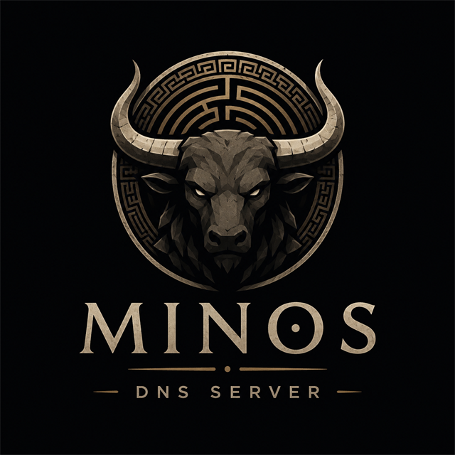
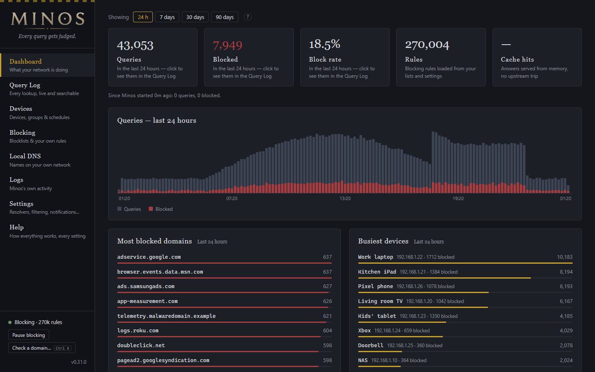
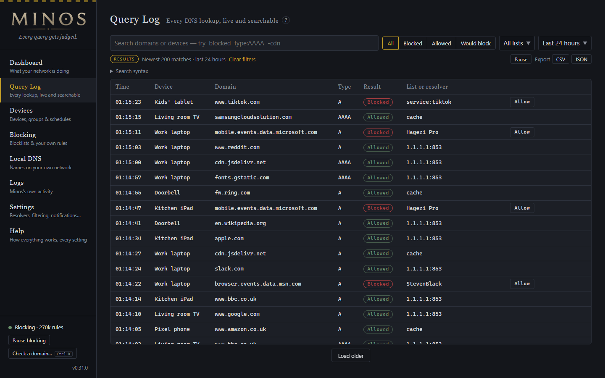
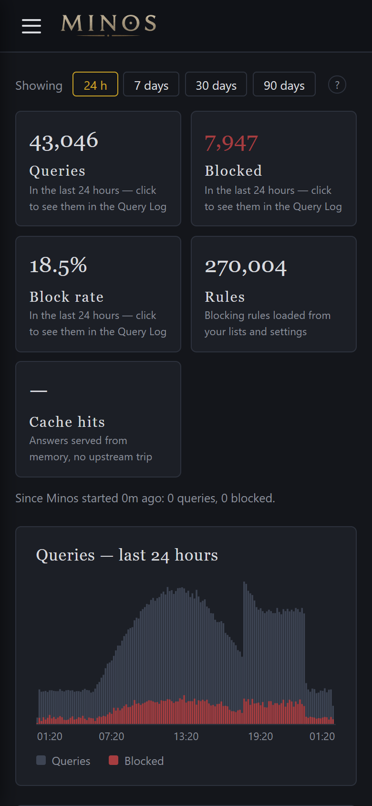
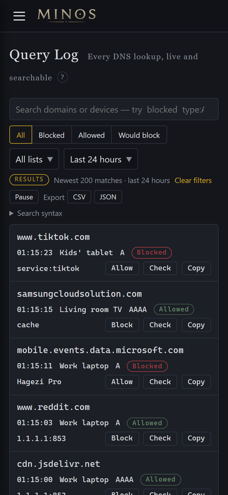

<p align="center">
  
</p>

[](https://x.com/DanDreadless)

# Minos

> Every query gets judged.

Minos is a network-wide ad, tracker and malware blocker for your home — a
modern alternative to Pi-hole and AdGuard Home, written in Go. It is one
static binary with the web interface built in, light enough for a
Raspberry Pi. Point your router's DNS at it and every device on the network
is protected, with a clear answer to "why was this blocked?" one click away.

<p align="center">
  
</p>

## Why Minos

- **Every block explains itself.** Each blocked lookup names the list and
  the rule that caught it, and **Allow** is right there on the row — never
  more than two clicks from seeing a block to fixing it. Or allow it for
  just an hour.
- **Spots infected devices.** Not just domains on a list: a device looking
  up many random-looking domains (malware hunting for its control server),
  sending data out hidden in long DNS names, or reaching for known
  malicious domains is flagged by name — tuned on 90 days of a real home
  network to stay quiet when nothing is wrong.
- **Notices when blocking breaks something.** A device retrying a blocked
  name, the way an app does when it has stopped working, shows up as
  "Something may be broken on Living room TV" with Allow, Allow 1 h and
  Dismiss — while tracker chatter that nags all day is left out.
- **Try a list before you trust it.** Audit mode shows what a new blocklist
  *would* block without blocking anything, so you can add a strict list
  without breaking the house.
- **Undo for settings.** Every change is recorded with who made it and
  what it touched; see the change line by line (secrets hidden) and put
  back any earlier version in one click.
- **Knows your devices.** Names come from DHCP, mDNS, UPnP, NetBIOS and the
  MAC vendor registry, and rules follow a device across address changes.
- **Modern DNS, both ways.** Upstreams over DoH, DoH3, DoT or DNS-over-QUIC;
  devices can use Minos over DoT, DoH, HTTP/3 or QUIC, and Windows 11, iOS
  and macOS find the encrypted endpoints by themselves (DDR).
- **Validates DNSSEC itself** — and tells you what enforcing it would cost
  before you turn it on.
- **Updates itself, safely.** One click installs a signed release and puts
  the old one back if the new one does not start.
- **No telemetry. Ever.**

## Features

**Blocking**

- Hosts, plain-domain and AdBlock-syntax blocklists, with a curated catalog
  (balanced, strict, security, family) verified to compile; lists keep
  working from a local copy when their host is down, retry sensibly, refuse
  a suspiciously shrunken update, and fall back to publisher mirrors
- Your own allowed and blocked domains, including `/regex/` rules, and
  subscribed allowlists
- **CNAME-cloak inspection**: a tracker hiding behind a first-party name
  (`metrics.shop.com → tracker.net`) is still blocked
- One-click blocked services (TikTok, YouTube, Discord…) and your own
  custom services, globally or per group
- Blocked answers as `0.0.0.0`/`::` or NXDOMAIN, with Extended DNS Errors
  (RFC 8914) naming the list for clients that ask
- Pause blocking for 5 minutes, an hour, or until you resume — from the
  menu, the CLI or the API

**For the household**

- Device groups with their own extra rules, full bypass, or no DNS at all,
  on schedules ("no social media after 21:00 on school nights")
- Safe Search enforced for Google, Bing, DuckDuckGo and YouTube — network
  wide or per group
- Firefox's automatic DNS-over-HTTPS switched off network-wide, and iCloud
  Private Relay blockable, so filtering can't be bypassed quietly

**For the network**

- Local DNS records (`nas.home.arpa`, wildcards, CNAMEs, automatic PTR) and
  conditional forwarding to your router
- Private reverse lookups answered locally (RFC 6303) — `192.168.x.x`
  never leaks to public resolvers
- DNS rebinding protection, per-device rate limiting, and an open-resolver
  guard that answers only your own networks
- A response cache with request collapsing and serve-stale (RFC 8767), and
  failing upstreams sidestepped automatically
- Certificates for encrypted DNS fetched and renewed for you (Let's Encrypt
  via Cloudflare, deSEC, DuckDNS or RFC 2136)

**Running it**

- A fast Query Log over the full history: search by domain or device, by
  result, list, type or time, with filters you can type (`blocked
  type:AAAA -cdn`) — results in milliseconds on millions of rows
- Dashboard windows from 24 hours to 90 days, every number clickable into
  the matching queries; host health (CPU, memory, temperature, disk) on
  non-container installs
- Minos's own application log in the browser, live, with secrets redacted
- **Help** built in: every page and every setting explained, the same guide
  as [docs/user-guide.md](docs/user-guide.md)
- Password sign-in with optional authenticator-app codes, plus API tokens
  for automation
- Notifications by webhook or [ntfy](https://ntfy.sh) that say what
  happened and what to do: a new device, a failing list or resolver, DNS
  down, an update installed
- Migrate from Pi-hole or AdGuard Home in one command or one upload; export
  and restore the whole configuration
- Prometheus `/metrics` with a ready-made
  [Grafana dashboard](deploy/grafana-dashboard.json), a
  [documented REST API](docs/api.md) and
  [Home Assistant recipes](docs/home-assistant.md)
- Built for SD cards: query-log writes are batched, memory use is capped,
  and nothing slow ever stands between a reboot and working DNS
- Works on a phone: every page reflows to a phone screen

<p align="center">
  
</p>

<p align="center">
  
  &nbsp;
  
</p>

## How it compares

As of October 2026, against each project's current release. ✅ yes ·
— no · ◐ partly.

| | Minos | Pi-hole v6 | AdGuard Home |
|---|:-:|:-:|:-:|
| Names the list *and rule* behind every block, with one-click allow | ✅ | ◐ | ✅ |
| Audit (dry-run) blocklists | ✅ | — | — |
| Flags infected devices by behaviour (DGA, DNS tunnelling) | ✅ | — | — |
| In-process DNSSEC validation | ✅ | — | — |
| Settings history with one-click undo | ✅ | — | — |
| One-click update from the web interface | ✅ signed, auto-rollback | — | ✅ |
| Encrypted DNS for devices (DoT / DoH / DoQ / HTTP/3) | ✅ | — | ✅ |
| DDR — devices upgrade to encrypted DNS automatically | ✅ | — | ✅ |
| CNAME-cloak inspection | ✅ | ✅ | ✅ |
| Regex rules | ✅ | ✅ | ✅ |
| Per-device rate limiting & open-resolver guard | ✅ | ◐ | ✅ |
| Device groups with schedules | ✅ | ◐ | ◐ |
| Blocked-services catalog & Safe Search | ✅ | — | ✅ |
| Password login with two-step codes | ✅ | ✅ | ◐ |
| Application log in the web interface | ✅ | ✅ | — |
| DHCP server | — by design | ✅ | ✅ |
| Recursive resolver | — by design | add-on | — |

Minos forwards to the upstream resolvers you choose rather than resolving
recursively itself, and leaves DHCP to your router.

## Quick start

On a Raspberry Pi or any Linux box — amd64, arm64, or 32-bit ARM (Pi Zero
through Pi 4 on 32-bit Pi OS) — one line installs the latest release, the
systemd unit and the updater:

```sh
curl -fsSL https://raw.githubusercontent.com/DanDreadless/minos/main/deploy/install.sh | sudo sh
sudo systemctl enable --now minos
```

Then open `http://<host>:8080`, set a password (Settings → Access &
security), and point your router's DHCP DNS option at the machine. Before
the first start, free port 53 (the `systemd-resolved` stub or `dnsmasq`)
— the walkthrough in [docs/getting-started.md](docs/getting-started.md)
covers it, along with a fixed IP and a firewall for ports 53 and 8080.

Prefer Docker? Multi-arch images are on GHCR:

```sh
docker run -d --name minos -p 53:53/udp -p 53:53/tcp -p 8080:8080 \
  -v minos-data:/data ghcr.io/dandreadless/minos:latest
```

Or build from source (Go 1.22+, Node 20+):

```sh
make build          # builds the web interface and one binary into bin/minos
./bin/minos serve   # DNS on :53 and the web interface on :8080
```

The first run writes a commented default config to `minos.yaml`.

The `minos` command talks to the running instance:

```sh
minos status                      # counters, rules, pause state
minos pause 5m                    # pause blocking for five minutes
minos resume                      # resume blocking
minos import pihole /etc/pihole   # bring your Pi-hole settings with you
minos logs -f                     # follow Minos's own log (also on the Logs page)
```

## Updating

With the update check on (Settings → System), a banner announces new
releases. On installs made with the script above, **Update now** downloads
the release, checks its signature and that it is newer, installs it and
restarts — and puts the previous version back by itself if the new one does
not answer within 30 seconds. Minos itself never runs as root: a small
systemd helper does the installing. Docker installs update with
`docker compose pull && docker compose up -d`.

## Documentation

- [User guide](docs/user-guide.md) — every page and every setting, with
  defaults and config keys (the same guide is built into Minos: **Help**)
- [Getting started](docs/getting-started.md) — install, host preparation,
  encrypted DNS, monitoring, upgrading, and the full config reference
- [REST API reference](docs/api.md) — every endpoint, with examples
- [Home Assistant recipes](docs/home-assistant.md) — a blocking switch,
  sensors, bedtime automations, events on your phone
- [Roadmap](docs/roadmap.md) — what has shipped and what is being considered
- [Releasing](docs/releasing.md) — for maintainers: the release flow and
  signing key

## Developing

Go 1.22+, Node 20+. `make test` runs the Go suite with the race detector,
`make lint` runs golangci-lint and the frontend type check, and `make bench`
runs the filter-engine benchmarks. For local development without root, set
`dns.listen: ":5353"` and test with `dig @127.0.0.1 -p 5353
doubleclick.net`. See `CLAUDE.md` for the architecture, conventions and
performance budgets.

## License

GPLv3.
